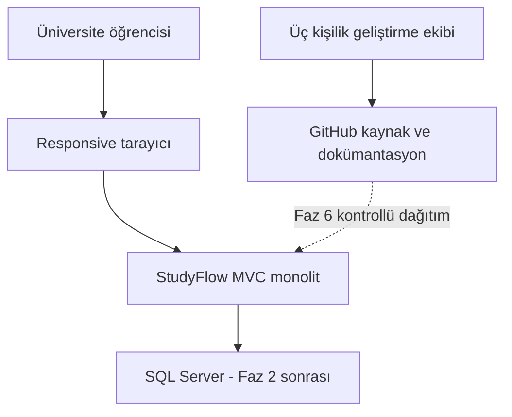

# StudyFlow

Öğrencilerin derslerini, sınavlarını, görevlerini ve çalışma sürelerini tek yerde takip etmesi için tasarlanan ASP.NET Core MVC projesi.

**Durum:** Analiz ve tasarım. Bu paket uygulama kaynak kodu, migration veya çalıştırılmış uygulama testi içermez. İlk ders teslimi ile ürünün tamamlanması ayrı aşamalardır.

## Proje ne yapar?

Öğrenci bir ders ve konu oluşturur, yapılacak işi görev olarak kaydeder, görevi bir güne planlar ve gerçekleşen çalışmasını oturum olarak ekler. Dashboard ve istatistik ekranları planlanan süre ile gerçek süreyi karşılaştırır.

Örnek: “20 soru çöz” bir görevdir; pazartesiye 60 dakika ayırmak bir plandır; o gün 45 dakika çalışmak bir oturumdur. Oturumu bitirmek görevi kendiliğinden tamamlamaz.

## Sistem bağlamı

İlk faz örnek veriyle çalışır; SQL Server Faz 2'de eklenir. GitHub geliştirme ve dağıtım aracıdır, öğrencinin uygulamayı kullanırken erişmesi gereken bir servis değildir.

## Teknolojiler

C#, ASP.NET Core MVC, Razor, EF Core, SQL Server, Bootstrap ve xUnit hedeflenmektedir. .NET ve paket sürümleri, ders laboratuvarıyla uyum ve resmi destek durumu doğrulanarak seçilecektir.

Tek uygulama içinde controller, servis, domain ve veri erişim sorumlulukları ayrılır. REST API isteğe bağlı bir genişletmedir; MVC servisleri doğrudan çağırır.

## İlk ders teslimi

| Controller | İki ayrı View |
| --- | --- |
| DashboardController | Index, Weekly |
| CoursesController | Index, Details |
| ExamsController | Index, Details |

Altı ekran ortak navigasyon, responsive CSS ve Razor ile üretilen dinamik örnek veri içerir. Layout ve partial dosyaları altı View hesabına katılmaz. Bu aşamada veritabanı ve giriş sistemi gerekli değildir; ekranlarda örnek veri etiketi bulunur.

## Dokümanlar

| Belge | Ne zaman okunmalı? |
| --- | --- |
| [Kapsam ve kurallar](docs/01-kapsam-ve-kurallar.md) | Bir özelliğin nasıl davranacağını belirlerken |
| [Teknik tasarım](docs/02-teknik-tasarim.md) | Model, veritabanı ve servis geliştirirken |
| [Ekranlar](docs/03-ekranlar.md) | Controller, View ve form geliştirirken |
| [Geliştirme planı](docs/04-gelistirme-plani.md) | Faz, ekip görevi ve dağıtım planlarken |
| [Test ve kabul](docs/05-test-ve-kabul.md) | Bir işin tamamlandığını doğrularken |
| [Katkı rehberi](CONTRIBUTING.md) | Branch ve pull request açarken |

Beş diyagram ilgili belgelere gömülüdür: sistem bağlamı bu sayfada; kullanıcı akışı kapsam belgesinde; bileşen mimarisi ve varlık ilişkileri teknik tasarımda; dağıtım geliştirme planında. Ayrı `.mmd` dosyalarıyla ikinci bir kopya tutulmaz.

## Başlangıç

1. Üç kişilik ekip ilk teslim koşullarını ve SDK seçimini netleştirir.
2. `src/StudyFlow.Web` altında MVC uygulaması oluşturulur.
3. Ortak ViewModel ve DemoData sözleşmeleri belirlenir; altı ekran geliştirilir.
4. İlk teslim kabul edildikten sonra kalıcı veri ve diğer modüllere geçilir.

Uygulama oluştuğunda kaynaklar `src/`, testler `tests/` altında tutulur. Kurulum ve çalıştırma komutları o sırada gerçek proje yollarına göre eklenir.

## GitHub'a ilk yükleme

Yeni, boş bir GitHub deposu oluştur. ZIP'i çıkart; içindeki `StudyFlow` klasörünü aç. `README.md`, `CONTRIBUTING.md`, `.gitignore` ve `docs` klasörünü birlikte deponun köküne yükle. ZIP dosyasını kaynakların yerine yükleme. Windows'ta `.gitignore` görünmüyorsa gizli dosyaları göster.

Mevcut uygulama deposuna eklerken bu README'yi uygulamanın README'siyle birleştir; belgeleri `docs` altında tut. Aynı belgelerin ikinci bir eski kopyasını depoda tutma.

## Sadeleştirme kararları

24 kaynak belge beş ana belgede birleştirildi. FR-001–036 kimlikleri korundu; aynı davranışı tekrarlayan iş kuralı, kullanıcı hikâyesi ve test açıklamaları tek yerde toplandı. Ayrıntılı REST endpoint kataloğu, ayrı izlenebilirlik matrisi ve eski teslim raporu çıkarıldı. Diyagramlar ilgili Markdown belgesinin içine alındı.

Konu ve görevin ders bağlantısı oluşturulduktan sonra sabittir. Konu durumunu değiştirme temel kapsamdadır; konu notu ve tekrar tarihi isteğe bağlıdır. Bu kararlar sadeleştirilmiş belgelerin tamamında geçerlidir.

Hosting, e-posta doğrulama/kurtarma ve lisans henüz seçilmedi. Depoyu görünür yapmak kullanım lisansı oluşturmaz; lisans üç yazar ve dersin paylaşım politikası doğrultusunda ayrıca belirlenir.
