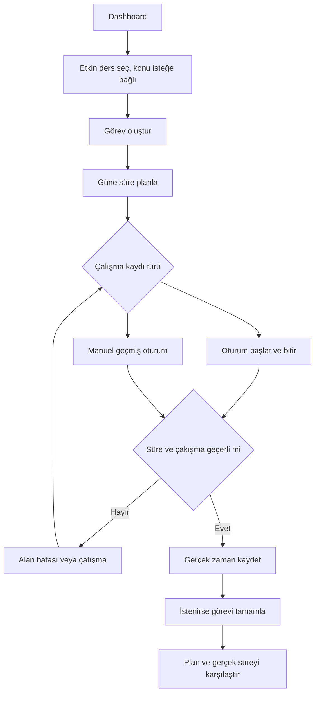

# Kapsam ve kurallar

[Ana sayfa](../README.md)

## Ürün sınırı

Hedef kullanıcı bireysel üniversite öğrencisidir. Ders, sınav, konu, görev, plan, oturum, dashboard, istatistik ve hesap yönetimi kapsam içindedir. AI, not tahmini, öğretmen/admin paneli, sosyal özellikler, okul ve takvim entegrasyonu, mobil uygulama ve bildirim servisi ilk sürümün dışındadır. CSV dışa aktarma sonraki sürüm fikridir.

İlk ders teslimi yalnız altı örnek veri ekranıdır. Ürün MVP'si, aşağıdaki Must davranışlarının kalıcı SQL Server üzerinde gerçek kullanıcı izolasyonuyla çalışmasıdır. Should işler ertelenebilir; ilgili fazın kabulünü tek başına durdurmaz. REST API MVP şartı değildir.

## Kullanıcı akışı

Bu diyagram görev planlanan bir örnektir. Konu seçimi ve plan oluşturmak zorunlu değildir; oturum görevsiz de kaydedilebilir. Oturumu bitirmek görevi otomatik tamamlamaz.

## İşlevler

FR kimlikleri önceki belgelerle ilişki kurmak için korunmuştur. Bu tablo ve aşağıdaki ortak kurallar davranışın tek kaynağıdır; aynı kuralı ayrı bir BR veya kullanıcı hikâyesi dosyasında tekrar tutmayın.

| Kimlik | Beklenen davranış | Öncelik |
| --- | --- | --- |
| FR-001 | Ders adı trim sonrası 1–120 karakter; haftalık hedef 0–10080 tam dakika; yeni ders aktif oluşturulur. | Must |
| FR-002 | Kullanıcının derslerini ad içinde harf duyarsız arama ve Active/Archived filtresiyle listele; ad, sonra Id sıralaması. | Must |
| FR-003 | Ders detayını göster; ad ve hedefi düzenle; eski RowVersion ile değişikliği engelle. | Must |
| FR-004 | Dersi arşivle/geri aç; açık oturum arşivi engeller; arşivde alt kayıtlar salt okunur. | Must |
| FR-005 | Yalnız hiçbir sınav, konu, görev, plan veya oturumu olmayan dersi sil; bağlı kayıtta arşiv öner. | Must |
| FR-006 | Aktif derse başlığı 1–120 karakter olan Midterm/Final/Quiz/Other sınavı ekle; geçerli geçmiş tarih kabul edilir. | Must |
| FR-007 | Sınav liste/detay ve Upcoming/Past/All filtresi; yaklaşan aralık now dahil, now+14 gün hariç; kalan gün yerel tarih farkı. | Must |
| FR-008 | Aktif dersteki sınavı düzenle/sil; ders değişiminde eski ve yeni ders aktif ve kullanıcıya ait olmalı. | Must |
| FR-009 | Aktif derse başlığı 1–160 karakter, SortOrder değeri >=0 olan konu ekle; SortOrder, sonra Id sıralaması. | Must |
| FR-010 | Konuyu NotStarted/InProgress/Completed durumları arasında değiştir. En fazla 2000 karakter not ve isteğe bağlı tekrar tarihi eklenebilir. | Durum Must; not/tekrar tarihi Should |
| FR-011 | Konu başlığı ve sırasını düzenle; görev veya oturumu bağlı konuyu silme; konunun dersi sabittir. | Must |
| FR-012 | Konu ilerlemesini Completed/toplam ×100 olarak göster; konu yoksa 0 ve açıklama; gösterim bir ondalık. | Must |
| FR-013 | Aktif derse Pending görev ekle; başlık 1–160, tahmin 1–1440 dakika, Low/Normal/High öncelik; konu isteğe bağlı ve aynı dersten. | Must |
| FR-014 | Görevi düzenle; dersi sabittir. Bağlı oturum varsa konusunu değiştirme; plan/oturum bağlı görevi silme. | Must |
| FR-015 | Pending/InProgress/Completed geçişlerini uygula; CompletedAt sunucu zamanı; tekrar Completed aynı zamanı korur; geri açmada temizlenir. | Must |
| FR-016 | Ders, son tarih, öncelik, durum ve gecikme filtreleri birlikte AND; DueOn < yerel bugün ve tamamlanmamış görev gecikmiştir; null son tarih gecikmez. | Must |
| FR-017 | Aktif dersteki görevi bir güne 1–1440 dakika planla; aynı görev/gün tek kayıt; farklı günler ve geçmiş günler kabul edilir. | Must |
| FR-018 | Planın görev/gün/süresini geçerli hedefle değiştir veya sil; planı silmek görev veya oturumu silmez. | Must |
| FR-019 | Günlük/haftalık planı göster; hafta pazartesi başlar; tarih uçları dahil; tamamlanma etiketi görevden türetilir. | Must |
| FR-020 | Plan ile gerçek süreyi aynı görev ve yerel günde eşleştir; eşleşmeyen süreyi plansız göster; toplamda her saniyeyi bir kez say. | Must |
| FR-021 | Timer başlangıcını sunucu belirler; kullanıcı başına tek açık oturum; seçilen görev/konu aynı ders ve kullanıcıya ait olmalı. | Must |
| FR-022 | Timer'ı sunucu zamanı ile bitir; süre pozitif ve en fazla 24 saat; tekrar bitirme mevcut bitişi korur; aşımda kurtarma akışı sun. | Must |
| FR-023 | Başlangıç < bitiş <= now olan, en fazla 24 saatlik manuel oturum ekle; kullanıcının başka oturumuyla çakışma olmasın. | Must |
| FR-024 | Bitmiş oturumu geçerli zaman ve ilişkilerle düzelt/sil; açık oturum yalnız bitirilebilir veya silinerek iptal edilir. | Must |
| FR-025 | Bitmiş oturumları yerel gün/hafta sınırında böl; açık oturum resmi toplamda yer almaz; saniyeleri topla, yalnız gösterimde dakikayı yuvarla. | Must |
| FR-026 | Aktif dersler, yaklaşan sınavlar, bekleyen/geciken görevler, son 5 tamamlanan görev, konu ilerlemesi, haftalık hedef/süre ve 7 günlük grafik. | Must |
| FR-027 | Gelişmiş istatistik: ders dağılımı, anlık görev tamamlanma oranı, konu ilerlemesi ve önceki eş uzunluklu aralığa göre süre değişimi. | Should |
| FR-028 | Kişisel haftalık hedef aktif derslerin hedef toplamıdır; ayrı kullanıcı hedefi veya geçmiş hedef snapshot'ı tutulmaz. | Must |
| FR-029 | Identity ile benzersiz e-posta, kayıt/giriş/POST çıkış; genel giriş hatası, parola ilkesi ve başarısız deneme kilidi. | Must |
| FR-030 | Kullanıcı kendi görünen adını (1–80) ve desteklenen IANA zaman dilimini değiştirebilir; geçmiş günlük gruplama yeni dilime göre hesaplanır. | Should |
| FR-031 | Liste, detay, toplam ve yazmalar sunucu kullanıcısına göre sınırlandırılır; başka kullanıcı kaydı/ilişkisi bulunamadı kabul edilir. | Must |
| FR-032 | 3 Controller ×2 anlamlı View; navigasyon, örnek veri etiketi, dinamik Razor ve boş durum; yanlış örnek Id bulunamadı sayfası. | Must / ilk teslim |
| FR-033 | 360/768/1440px ana içerik taşmaz; mobil menü, klavye odağı, form etiketleri ve erişilebilir hata anlatımı. | Must / ilk teslim |
| FR-034 | Yeni kayıt formlarında PRG ve OperationId/receipt ile tekrarı engelle; aynı anahtar/girdi aynı kaydı, farklı girdi çatışmayı verir. | Must |
| FR-035 | Düzenleme/silmede RowVersion kontrolü; eski sekme yeni veriyi sessizce ezemez; kullanıcıya yeniden yükleme seçeneği sunulur. | Must |
| FR-036 | Kimlik doğrulama öncesi yalnız Development ve yerelde sabit demo sahibi; bütün sorgular owner kapsamlı; demo modu diğer ortamlarda başlamaz. | Must |

## Ortak iş kuralları

- Ders adları aynı kullanıcıda tekrarlanabilir; dönem modeli ilk sürümde yoktur.
- Arşivli dersin geçmişi görüntülenebilir. Yeni alt kayıt, düzenleme, silme ve durum değişimi için önce ders geri açılır. Dersin geri açılması kendi düzenleme işlemidir.
- Konu ve görevin CourseId değeri oluşturulduktan sonra değişmez. Bu karar, EF alternatif anahtar tasarımıyla uyumludur. Taşıma ihtiyacı doğarsa ayrı kapsam ve veri modeli kararı gerekir.
- Görev tamamlamak konuyu, oturum bitirmek görevi otomatik tamamlamaz. Planın ayrı bir tamamlanma alanı yoktur.
- Oturumda TaskId varsa ders görevle aynıdır. Görevin konusu doluysa oturumun konusu da aynıdır; boş gönderilirse sunucu türetir. Görevin konusu yoksa aynı dersten bir konu seçilebilir.
- Konu/görev/oturum ilişkisi yoksa null kullanılabilir. Başka kullanıcıya ait ilişki kaydı bulunamadı; aynı kullanıcının yanlış ders ilişkisi doğrulama hatasıdır.
- Gerçek süre yalnız bitmiş oturumların zaman farkından gelir. Görev tahmini, plan süresi veya haftalık hedef gerçek süreyi artırmaz ya da sınırlamaz.
- Dashboard'un operasyonel kartları arşivli dersleri dışlar; gerçek süre toplamları arşivli derslerdeki geçmiş oturumları da içerir. Bekleyen görev sayısı Pending ve InProgress toplamıdır.
- Tamamlanma oranları mevcut aktif derslerin anlık durumudur; geçmiş görev durumu zaman serisi tutulmaz. Önceki süre 0 ise değişim yüzdesi null ve açıklama gösterilir.
- Tamamlanan görevler CompletedAt azalan, eşitlikte Id azalan sıralanır; sınavlar ScheduledAt, sonra Id artan sıralanır.

## Zaman ve karşılaştırma

Anlar UTC'ye çevrilir ve saniye hassasiyetine normalize edilir. Son gün, plan günü ve tekrar günü DateOnly'dir. Varsayılan zaman dilimi Europe/Istanbul, hafta başlangıcı pazartesidir. DisplayName varsayılanı “Öğrenci”dir; profil ekranı ertelense de kullanıcı zaman dilimi saklanır.

Oturum aralıkları başlangıç dahil, bitiş hariçtir: `[start, end)`. Bitişik oturumlar kabul edilir. Bir oturum pazar 23:30–pazartesi 00:30 ise iki gün ve haftaya 30'ar dakika dağıtılır. Aralık raporu yalnız başlangıcı içeride olan oturumları seçmez; aralıkla kesişen kısmı sayar. Yaz/kış saati değişiminde gerçek süre UTC farkıdır.

Pazartesi Task1 için plan 60, gerçek 45; salı aynı görevde plansız 30 ve pazartesi görevsiz 15 dakika varsa toplam gerçek 90, pazartesi plan farkı -15, plansız süre 45 dakikadır. Planı silmek gerçek toplamı değiştirmez; ilgili çalışma plansız sınıfına geçer.

## Unutulan zamanlayıcı

24 saatten uzun açık Timer otomatik bitirilmez; yeni Timer da başlatılamaz. Ekran kullanıcıya mevcut kaydın başlangıcını gösterir, iptal onayı sunar ve iptal sonrası manuel kayıt formuna yönlendirir. Kullanıcı hatırladığı başlangıç/bitişle en fazla 24 saatlik kayıtlar oluşturabilir. İptal ve manuel kayıt ayrı işlemlerdir; iptal edilen açık oturum istatistiğe yazılmaz. Aynı saniyede bitirme kabul edilmez; kullanıcı kısa süre sonra yeniden deneyebilir.

## Değişiklik

Yeni ders isteri kaynak/tarih bilgisiyle issue'ya eklenir. İlgili FR, model, ekran, test ve faz etkisi aynı değişiklikte değerlendirilir. Bilinmeyen sonraki ders şartları bu belgenin onaylanmış parçası sayılmaz.
