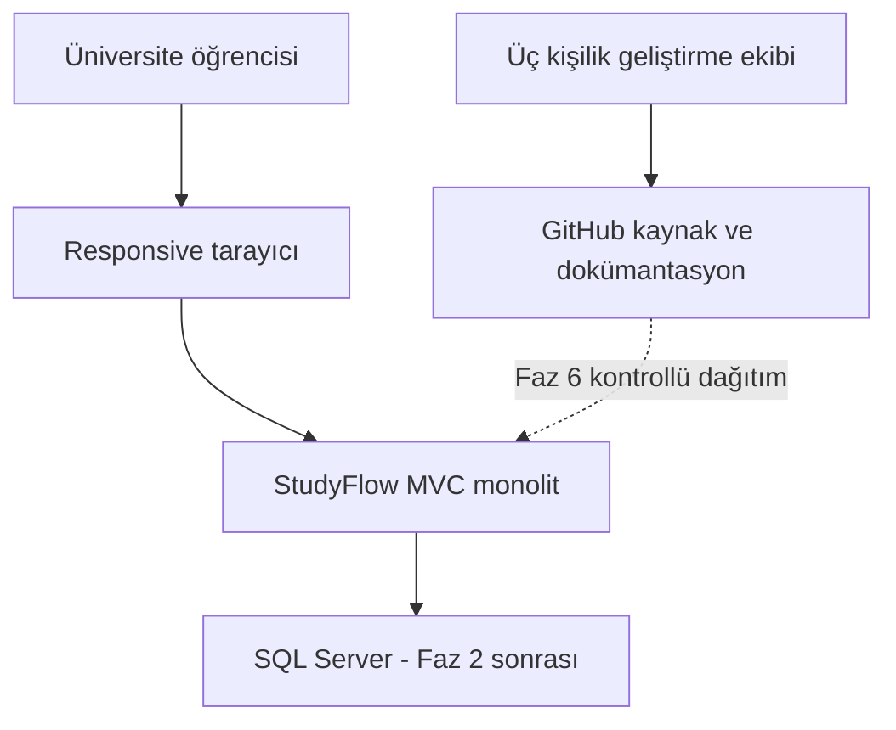

# Proje özeti

Durum: tasarım; bu depoda çalışan uygulama veya yürütülmüş uygulama testleri yoktur.

## Problem ve amaç
Ders, sınav, yapılacak iş ve gerçekleşmiş çalışma farklı araçlara dağılınca öğrenci neyi ne zaman çalıştığını karşılaştıramaz. StudyFlow bu kayıtları ilişkilendirir; sınav başarısı veya verimlilik artışı kanıtlanmış değildir.

Hedef kullanıcı bireysel üniversite öğrencisidir. Üç kişilik ekip, ASP.NET Core MVC dersinin bilinen ilk teslimini hazırlayacak; sonraki ders isterleri bilinmiyor. Amaç ilk teslimde anlaşılır navigasyon ve dinamik arayüz, ürün MVP'sinde güvenli kalıcı kayıt ve ölçülebilir çalışma takibidir.

## Kapsam ve başarı
Ders, sınav, konu, görev, plan, oturum, dashboard, istatistik ve hesap yönetimi kapsam içidir. İlk teslim başarısı FR-032/033; ürün başarısı Must gereksinimlerin kabulü ve iki kullanıcı izolasyon testleridir. Kullanıcı doğrulaması hedefi: üç öğrenci ders ekleme → görev planlama → oturum kaydetme akışını en fazla 5 dakikada tamamlayabilsin; ölçülmemiş hedef.

Kapsam dışı: AI, otomatik not tahmini, öğretmen/admin paneli, okul bilgi sistemi, sosyal özellikler, mobil uygulama, bildirim servisi, takvim entegrasyonu. Varsayım: internet tarayıcısı ve bireysel hesap; tek kurum/çok kiracılı model gerekmiyor. Kısıt: üç öğrencinin zamanı, SQL Server ve C# bilgisi; iş yükleri tahmin, ders takvimi henüz bilinmiyor.

[Sistem bağlamı](diagrams/system-context.mmd) ve [faz planı](16-development-roadmap.md).

[Dokümantasyon indeksi](../README.md)

## Diyagram

Öğrenci tarayıcıdan monolite erişir; veri SQL Server’dadır. GitHub geliştirme aracıdır, ürün çalışma zamanı bağımlılığı değildir.

