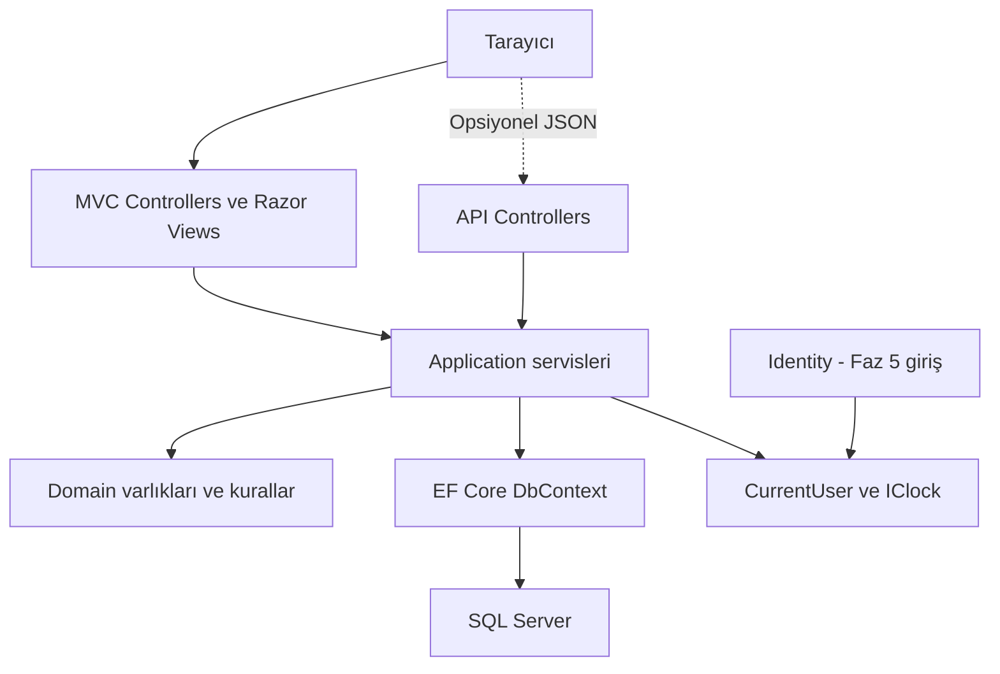
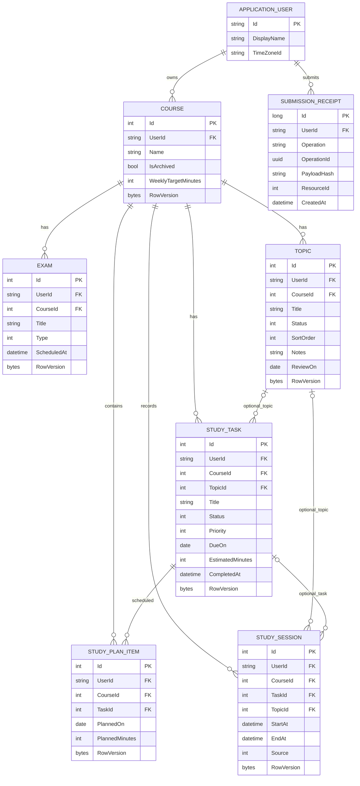

# Teknik tasarım

[Ana sayfa](../README.md) · [Kapsam ve kurallar](01-kapsam-ve-kurallar.md)

## Mimari

Tek ASP.NET Core MVC uygulaması ve tek SQL Server veritabanı kullanılır. Domain, Application ve Infrastructure aynı projenin klasörleridir; ayrı servis veya deployment değildir. Generic repository, CQRS ve mikroservis ilk sürüm için gerekli değildir.

Kesik bağlantıdaki API isteğe bağlı genişletmedir. İlk faz MVC/DemoData ile çalışır; Identity giriş akışı Faz 5'te etkinleşir.

İlk aşamada yalnız Controllers, Views, ViewModels, ViewComponents, DemoData, Helpers ve wwwroot bulunur. Faz 1B'de kalıcı veritabanı olmadan `IDemoCourseStore` / `DemoCourseStore` üzerinden tarayıcı oturumu (`ISession`) içinde JSON olarak geçici ders saklanır ve salt okunur `DemoData` ile birleştirilir; ders kartları ortak `_CourseCard.cshtml` PartialView'u (`CourseCardViewModel`), yaklaşan sınav özetleri ise `UpcomingExamsViewComponent` (`UpcomingExamsComponentViewModel`) üzerinden sunulur. Sonrasında Domain, Application ve Infrastructure eklenir. Controller form ve HTTP akışını, servis sahiplik/iş kuralı/transaction'ı, Razor sunumu üstlenir. MVC kendi HTTP API'sini çağırmaz.

Servisler: CourseService, ExamService, TopicService, StudyTaskService, StudyPlanService, StudySessionService, DashboardService, StatisticsService. Bütün belgelerde bu adlar kullanılır. DbContext ve servisler scoped; ICurrentUser istek kapsamlıdır. IClock testlerde sabit saat sağlar. Her sınıfa interface eklemek zorunlu değildir.

## Veri modeli

Id alanları kullanıcıda string, iş varlıklarında int; nullable alanlar `?` ile gösterilir. Her iş varlığında ayrıca sunucunun ürettiği `CreatedAt: DateTimeOffset` ve `RowVersion: byte[]` vardır. CreatedAt ve anlar UTC'dir; RowVersion SQL Server tarafından üretilir.

| Varlık | Ana alanlar |
| --- | --- |
| ApplicationUser | IdentityUser alanları; DisplayName (80), TimeZoneId (64) |
| Course | Id, UserId, Name (120), IsArchived, WeeklyTargetMinutes |
| Exam | Id, UserId, CourseId, Title (120), Type, ScheduledAt |
| Topic | Id, UserId, CourseId, Title (160), Status, SortOrder, Notes? (2000), ReviewOn? |
| StudyTask | Id, UserId, CourseId, TopicId?, Title (160), Status, Priority, DueOn?, EstimatedMinutes, CompletedAt? |
| StudyPlanItem | Id, UserId, CourseId, TaskId, PlannedOn, PlannedMinutes |
| StudySession | Id, UserId, CourseId, TaskId?, TopicId?, StartAt, EndAt?, Source |
| SubmissionReceipt | Id (long), UserId, Operation (64), OperationId (Guid), PayloadHash (64), ResourceId (int), CreatedAt; RowVersion yok |

ApplicationUser, Identity'nin AspNetUsers tablosudur; standart Identity tabloları tekrar tasarlanmaz. E-posta kayıt sırasında zorunlu ve normalize biçimde benzersizdir. Hesap silme ilk sürümün dışındadır.

User tüm iş kayıtlarının sahibidir. Course tüm ders kayıtlarının ebeveynidir. Task ve Session isteğe bağlı Topic'e; Plan zorunlu Task'a, Session isteğe bağlı Task'a bağlıdır. Plan ile Session arasında doğrudan FK yoktur; karşılaştırma görev ve yerel gün üzerinden yapılır.

### Varlık ilişkileri

Ortak CreatedAt ve standart Identity alanları görsel sadelik için kısmen gösterilmez. `datetime` SQL datetimeoffset, `bytes` RowVersion, enum alanlarının `int` gösterimi SQL tinyint anlamındadır. Null alanlar, bileşik owner FK'leri ve silme kuralları için bu belgedeki model ve kısıt açıklamaları esas alınır.

### Tipler ve kısıtlar

- Metinler nvarchar ve yukarıdaki üst sınırlarla; UserId nvarchar(450); takvim günleri date; anlar datetimeoffset(0); enumlar tinyint; version rowversion; hash char(64).
- ExamType: Midterm=0, Final=1, Quiz=2, Other=3. TopicStatus: NotStarted=0, InProgress=1, Completed=2. TaskStatus: Pending=0, InProgress=1, Completed=2. TaskPriority: Low=0, Normal=1, High=2. SessionSource: Timer=0, Manual=1.
- Course alternatif anahtarı `(UserId, Id)`; Topic ve StudyTask alternatif anahtarı `(UserId, CourseId, Id)`. Kullanıcı ve bu anahtarların ders alanları sonradan değişmez.
- Her UserId AspNetUsers'a; alt kayıtların `(UserId, CourseId)` alanı Course'a bağlanır. Topic/Task ilişkileri aynı kullanıcı ve dersi içeren bileşik FK ile kurulur. Nullable ilişkide yalnız TopicId/TaskId null olabilir.
- Bütün ilişkiler NO ACTION'dır. Course, Topic ve Task bağlı kayıt varken silinmez. Receipt.ResourceId genel amaçlı bir iş kaydı referansıdır; FK değildir.
- Unique: normalize e-posta; `(UserId, TaskId, PlannedOn)`; `(UserId, Operation, OperationId)`; Session için `(UserId) WHERE EndAt IS NULL`.
- Check: ders adının trim sonrası boş olmaması, sayısal sınırlar ve enum aralıkları; Task Completed ise CompletedAt dolu, diğer durumlarda null; açık Session yalnız Timer; bitmiş Session'da `EndAt > StartAt` ve süre en fazla 86400 saniye.
- Gelecek zaman ve ilişkiler arası konu uyumu servis tarafından IClock ile kontrol edilir. DB check, kullanıcıya gösterilen doğrulamanın yerine geçmez.

Başlangıç indeksleri: Course(UserId, IsArchived, Name), Exam(UserId, ScheduledAt), Task(UserId, Status, DueOn), Topic(UserId, CourseId, SortOrder), Plan(UserId, PlannedOn), Session(UserId, StartAt). Gerçek sorgu planına göre gereksiz olanlar çıkarılır; DurationMinutes/ActualMinutes ve kalıcı istatistik tablosu eklenmez.

## Güvenilir yazma

Yeni kayıt formunda sunucunun oluşturduğu OperationId bulunur. Normalize komutun SHA256 özetiyle receipt ve iş kaydı aynı transaction'da yazılır. Aynı kullanıcı/işlem/anahtar ve aynı girdi ilk oluşturulan kayda döner; farklı girdi çatışır. İlk kaynak silinmişse tekrar oluşturmak yerine çatışma verilir. Yeni bir oluşturma denemesi yeni anahtar kullanır. Receipt parola/kayıt/giriş gövdeleri için kullanılmaz; süreli temizleme kararı ertelenmiştir.

Düzenleme ve silme formu mevcut RowVersion'ı base64 taşır; istemci yeni version atayamaz. Eski token veri ezmez. POST sonrası redirect kullanılır; form butonunu devre dışı bırakmak tek başına tekrar koruması değildir.

Oturum oluştur/bitir/düzelt/sil, ders arşivle ve ders alt kaydı yazma işlemleri transaction başında aynı AspNetUsers satırını parametreli SQL ile `UPDLOCK, HOLDLOCK` alarak kilitler. Aynı kilit sırası korunur; sonra güncel sahiplik, ders durumu ve çakışma kontrol edilir. Böylece kontrol ile kayıt arasındaki yarış kullanıcı başına sıralanır. RowVersion ve unique indeksler ek korumadır; SQL davranışı gerçek yarış testleriyle doğrulanmalıdır.

Çakışma: `existing.StartAt < new.EndAt` ve `(existing.EndAt == null veya existing.EndAt > new.StartAt)`; düzenlemede kendi kayıt kimliği hariç tutulur. Açık oturum geleceğe uzanan aralık sayılır. Başlatma ve bitirme de aralık kontrolünden geçer.

## Kimlik, güvenlik ve hata

Faz 2'de demo ApplicationUser ve owner FK'leri kurulur. Demo sahibi yalnız Development/yerel kullanım içindir. Faz 5'te gerçek Identity cookie/claims devreye girer; ICurrentUser yoksa servis çalışmaz. İstemciden UserId alınmaz; her sorgu ve toplam kullanıcı kapsamındadır. Arşiv geçmişinin okunmasında aktif ders şartı aranmaz.

Formlar ViewModel'e bağlanır; EF entity doğrudan model binding'e açılmaz. UserId, CreatedAt, CompletedAt ve Session.Source sunucudan gelir. İstemci yalnız mevcut RowVersion token'ını geri taşır. Metinler trim edilir; sunucu alan, ilişki ve zaman kontrollerini istemci doğrulaması geçse bile yapar. Yerel saat formunda DST nedeniyle belirsiz veya var olmayan saat açık seçim/alan hatasıyla çözülür; sunucu sessizce bir an seçmez.

Identity parola hashing/validator/lockout kullanılır. Hedef politika: 12–128 karakter; 5 başarısız girişte 15 dakika kilit; paste/password manager desteği. Giriş hatası hesap varlığını açıklamaz. E-posta doğrulama/kurtarma sağlayıcısı ayrıca seçilir; sağlayıcı olmadan doğrulanmış e-posta şartı açılmaz.

Yazan MVC formları ve logout POST anti-forgery ister. Razor kullanıcı metnini encode eder; notlar düz metindir, Html.Raw kullanılmaz. Production HTTPS/HSTS, güvenli HttpOnly cookie ve kalıcı DataProtection anahtarları gerekir. Sırlar user-secrets/ortam değişkeninde; SQL ve yedek erişimi kısıtlıdır. Loglarda parola, cookie/token, e-posta, kişisel not, body veya bağlantı bilgisi bulunmaz; beklenmedik hata traceId ile izlenir.

| Durum | MVC davranışı |
| --- | --- |
| Geçersiz form girdisi | Aynı View ve alan hataları; HTTP 200 |
| Bozuk route Id veya geçersiz anti-forgery | HTTP 400; işlem yapılmaz |
| Kayıt yok veya başka kullanıcıya ait | Aynı genel bulunamadı sayfası; HTTP 404 |
| Giriş yok | Yerel returnUrl ile girişe yönlendirme |
| Arşiv, bağlı silme, duplicate, çakışma veya eski version | Anlaşılır çatışma sayfası/mesajı; HTTP 409 |
| Beklenmedik hata | Genel sayfa ve traceId; HTTP 500; stack trace gösterilmez |

Yalnız beklenen constraint ve iş kuralı ihlalleri çatışmaya çevrilir; her DbUpdateException 409 sayılmaz. Beklenmedik DB hataları genel 500 ve traceId yolunu izler.

İsteğe bağlı API ayrı adapter olur; aynı servisleri çağırır, DTO/ProblemDetails döndürür. Cookie API yazmalarında da anti-forgery gerekir; girişsiz API 401 döner. Ayrıntılı endpoint, header, sayfalama ve HTTP sözleşmeleri ancak API işi açılırsa ayrıca hazırlanır; MVP'de 34 endpoint geliştirme yükü yoktur.

## Uygulama sırasında doğrulanacaklar

SDK/EF/test paketi uyumu, DateOnly eşlemesi, IANA zaman dilimi desteği ve Identity ayarları seçilen ortamda doğrulanır. Paket sürümleri/global.json o karardan sonra sabitlenir. Konu/görev dersinin sabit tutulma gerekçesi: [EF Core alternatif anahtarları](https://learn.microsoft.com/en-us/ef/core/modeling/keys#alternate-keys).
