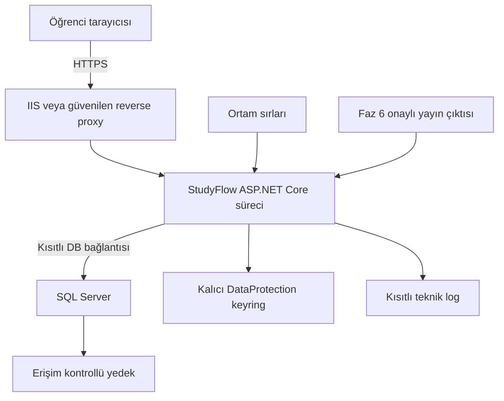

# Geliştirme planı

[Ana sayfa](../README.md) · [Test ve kabul](05-test-ve-kabul.md)

## Fazlar

Fazlar takvim haftası değildir. Yalnız ilk ders tesliminin koşulları biliniyor; sonraki ders isterleri açıklanınca sıra ve kapsam güncellenir. Ürün geliştirme planı, öğretim görevlisinin ilan edilmiş takvimi sayılmaz.

| Faz | Çıktı | İlgili FR / geçiş koşulu |
| --- | --- | --- |
| 0 — Hazırlık | Kapsamı birlikte oku; görev/plan/oturum ayrımını açıkla; SDK, kapasite ve paylaşım kararlarını kaydet. | İlk teslim koşulları ve açık kararlar net. |
| 1 — MVC iskeleti | DemoData, ortak layout/CSS, üç Controller ve altı View. | FR-032/033; menü, Razor, boş durum ve responsive kabulü. |
| 2 — Kalıcı veri | Demo ApplicationUser, Course/Exam/Receipt, DbContext, ilk migration, CRUD, arşiv, version ve tekrar koruması. | FR-001–008,028,034–036; gerçek SQL kalıcılık ve bütünlük testleri. |
| 3 — Konu/görev/plan | Topic/Task/Plan, durumlar, filtreler, plan ekranları ve migration. | FR-009–019; konu durumu Must, not/tekrar tarihi Should. |
| 4 — Gerçek çalışma | Timer/manuel oturum, düzeltme/iptal, yerel gün hesabı, dashboard ve plan karşılaştırması. | FR-020–026; FR-027 Should. Yarış, süre ve kurtarma testleri. |
| 5 — Gerçek kullanıcı | Identity kayıt/giriş/çıkış, claim kullanıcısı, iki kullanıcıyla izolasyon ve güvenlik. | FR-029/031; FR-030 Should. Kimlik ve owner testleri geçmeden public yayın yok. |
| 6 — Yayın adayı | Must regresyonu, ölçümler, migration/restore, HTTPS ve yapılandırma, sunum. | Kritik güvenlik ve veri bütünlüğü başarısızsa kapı kapanır. |

Her faz önceki işlerin regresyonunu içerir. Should özellik ertelendiyse açıkça “ertelendi” yazılır; başarılmış test gibi işaretlenmez. API geliştirilmezse API kontrolleri gerekçeli N/A'dır; MVC/domain kabulü devam eder.

Önceki taslağın başlangıç tahmini 192–312 ekip saatidir; üç kişide kişi başına yaklaşık 64–104 saat. Bu, kalan işin ölçümü değildir. Öğrenme, yeni ders isterleri ve API işi tahmini artırabilir; ilk sprint sonrası gerçek kapasiteye göre yeniden hesaplanır.

## Üç kişilik görev dağılımı

İsimler belli olmadığı için A/B/C kullanılır. Her üye kendi ekran, servis, doğrulama, test ve belge değişikliğini üstlenir. Bir kişi yalnız test veya yalnız doküman sorumlusu olmaz.

| Faz | Üye A | Üye B | Üye C |
| --- | --- | --- | --- |
| 1 | Courses Index/Details ve kendi responsive ekranları | Exams Index/Details ve kendi responsive ekranları | Dashboard Index/Weekly; ortak layout koordinasyonu |
| 2 | Course CRUD/arşiv ve testleri | Exam CRUD/testleri; DbContext koordinasyonu | Receipt/RowVersion, platform testleri ve build/CI |
| 3 | Konular ve testleri | Görevler ve testleri | Planlar ve testleri; migration koordinasyonu |
| 4 | Timer başlat/bitir/iptal | Manuel oturum/düzeltme; zaman bölme | Dashboard/istatistik; sorgu ve karşılaştırma |
| 5 | Identity akışı ve gerçek cookie testi | Owner/CSRF, A/B izolasyonu | Profil Should, güvenli hata ve demo guard |
| 6 | UI/kabul ve responsive | Migration/restore ve ortam runbook'u | Performans/CI ve yayın koordinasyonu |

Ortak DTO'lar ve sahiplik sözleşmesi başlangıçta belirlenir. Timer ve manuel akış aynı StudySessionService'i paylaştığından dosya değişiklikleri tek owner/PR sırasıyla koordine edilir. Layout, Program.cs ve DbContext koordinatörü her fazda döner. Her hafta 20 dakikada kapasite, engel ve yeni isterler gözden geçirilir; sayı veya satır eşitliği için gereksiz iş üretilmez.

## Tamamlanma ölçütü

İlgili FR ve olumsuz kabul koşulu doğrulanmış; uygun kontroller geçmiş; SQL davranışı gerçek SQL üzerinde sınanmış; belge güncel; başka üye PR'ı incelemiş; owner veri akışını açıklayabiliyor; main çalıştırma kontrolü yapılmış olmalıdır.

## Dağıtım özeti

Şema Faz 6 için hedef yayın ortamıdır; hosting sağlayıcısı henüz seçilmemiştir. IIS ile reverse proxy alternatiflerdir. Sırlar, loglar ve yedeklere erişim ayrı sınırlandırılır.

- Faz 1 yerel örnek veri; Faz 2–4 yerel demo. DemoMode Development dışında açıkken uygulama fail-fast yapar. Public ortam yalnız gerçek kimlik ve izolasyon kapısından sonra açılır.
- Hosting ve SQL erişimi bütçeye göre seçilir. Gizli bağlantı yerelde user-secrets, yayında secret store/ortam değişkenindedir. Örnek anahtarlar: `ConnectionStrings__StudyFlow`, `ASPNETCORE_ENVIRONMENT`, `StudyFlow__DemoMode`, `StudyFlow__DefaultTimeZoneId`.
- Production'da HTTPS, güvenilen proxy ayarı, kapalı ayrıntılı hata, kalıcı DataProtection anahtarları ve kısıtlı DB ağı/izinleri gerekir. Geliştirme seed'i production'da çalışmaz.
- Şema değişimi: yedek al → staging'e geri yükle → migration script'ini incele/uygula → smoke ve bütünlük kontrolü. Startup otomatik migrate kullanılmaz; uygulama rollback'i şema rollback'i yerine geçmez.
- Başlangıç yedek hedefi günlük, en fazla 24 saat veri kaybı ve en fazla 2 saat restore'dur. Hedefler host seçildikten sonra ölçülür; restore deneyi olmadan doğrulanmış kabul edilmez.

## Açık kararlar ve ana riskler

SDK/paket uyumu, hosting/bütçe, lisans/paylaşım, e-posta doğrulama/kurtarma/rate limit ve veri saklama/hesap silme politikası ayrı issue olarak karara bağlanır. Gerçek hizmet varmış veya hukuki uygunluk tamamlanmış gibi gösterilmez.

En önemli riskler kapsam büyümesi, C#/EF öğrenme süresi, ortak dosya çatışması, AI kodunun anlaşılamaması, veri kaybı ve kullanıcı verilerinin karışmasıdır. Çözüm sırası: işi küçük parçala; Must'a öncelik ver; ortak dosyayı koordine et; açıklanamayan kodu sadeleştir; migration/restore ve A/B testleriyle kapıyı doğrula. Sır sızıntısında sır iptal edilip yenilenir; sadece dosyadan silmek yeterli değildir.
