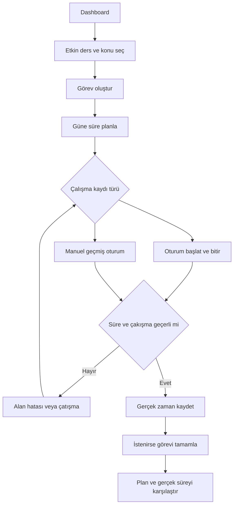

# Kullanıcı hikâyeleri ve kullanım senaryoları

Durum: tasarım; bu depoda çalışan uygulama veya yürütülmüş uygulama testleri yoktur.

## Roller
Faz 1 örnek öğrenci; Faz 2–4 yerel demo öğrenci; Faz 5 giriş yapan öğrenci ve girişsiz ziyaretçi. Yönetici rolü kapsam dışı.

### US-001

Bir öğrenci olarak ders oluşturma işlemini yapmak istiyorum, böylece akademik çalışmamı takip edebilirim.

**Kabul:** Ad trim sonrası 1–120 karakter; hedef 0–10080 tam dakika. Geçerli kayıt listede görünür.
**Alternatif/hata:** Boş ad veya sınır dışı hedef kaydı engeller.
**İlişki:** FR-001, TC-001, Faz 2.

### US-002

Bir öğrenci olarak ders listeleme ve filtre işlemini yapmak istiyorum, böylece akademik çalışmamı takip edebilirim.

**Kabul:** Sadece mevcut kullanıcı kapsamı; ad içinde büyük/küçük harf duyarsız arama; Active/Archived filtresi; ad, sonra Id sırası.
**Alternatif/hata:** Geçersiz durum 400; sonuç yoksa boş liste.
**İlişki:** FR-002, TC-002, Faz 2.

### US-003

Bir öğrenci olarak ders detay ve düzenleme işlemini yapmak istiyorum, böylece akademik çalışmamı takip edebilirim.

**Kabul:** Sahip olunan ders getirilir; geçerli değişiklik kaydedilir; RowVersion eskiyse 409.
**Alternatif/hata:** Eksik kayıt 404; hatalı değer 400.
**İlişki:** FR-003, TC-003, Faz 2.

### US-004

Bir öğrenci olarak ders arşivleme ve geri açma işlemini yapmak istiyorum, böylece akademik çalışmamı takip edebilirim.

**Kabul:** Arşiv geçmişi korur; arşivli derste yeni konu, sınav, görev, plan, oturum engellenir; açık oturum varken arşiv 409.
**Alternatif/hata:** Arşivli dersin tamamlanmamış görev ve planları salt okunur; geri açılınca yeniden etkin.
**İlişki:** FR-004, TC-004, Faz 2.

### US-005

Bir öğrenci olarak sınav oluşturma işlemini yapmak istiyorum, böylece akademik çalışmamı takip edebilirim.

**Kabul:** Aktif ve sahip olunan derse sınav eklenir; başlık 1–120; desteklenen tür; geçmiş tarih tarihsel kayıt olarak kabul edilir.
**Alternatif/hata:** Bozuk/eksik tarih 400; ders yok veya başkasına aitse 404.
**İlişki:** FR-006, TC-006, Faz 2.

### US-006

Bir öğrenci olarak sınav liste ve detay işlemini yapmak istiyorum, böylece akademik çalışmamı takip edebilirim.

**Kabul:** Upcoming: now <= tarih < now+14 gün; Past: tarih < now; kalan gün yerel takvim tarih farkı.
**Alternatif/hata:** Boş liste geçerlidir; bilinmeyen scope 400.
**İlişki:** FR-007, TC-007, Faz 2.

### US-007

Bir öğrenci olarak konu ekleme ve liste işlemini yapmak istiyorum, böylece akademik çalışmamı takip edebilirim.

**Kabul:** Başlık 1–160; sıra >=0; ders içinde SortOrder, Id sıralaması.
**Alternatif/hata:** Arşivli ders 409; geçersiz sıra 400.
**İlişki:** FR-009, TC-009, Faz 3.

### US-008

Bir öğrenci olarak konu durumu ve notu işlemini yapmak istiyorum, böylece akademik çalışmamı takip edebilirim.

**Kabul:** Not en fazla 2000; NotStarted/InProgress/Completed; tekrar tarihi opsiyonel; geçmiş tekrar tarihi kabul edilir.
**Alternatif/hata:** Bilinmeyen durum veya geçersiz takvim tarihi 400.
**İlişki:** FR-010, TC-010, Faz 3.

### US-009

Bir öğrenci olarak konu ilerleme işlemini yapmak istiyorum, böylece akademik çalışmamı takip edebilirim.

**Kabul:** Tamamlanan / toplam * 100; gösterim bir ondalık; konu yoksa 0 ve henüz konu yok etiketi.
**Alternatif/hata:** Oturum süresi konuyu otomatik tamamlamaz.
**İlişki:** FR-012, TC-012, Faz 3.

### US-010

Bir öğrenci olarak görev oluşturma işlemini yapmak istiyorum, böylece akademik çalışmamı takip edebilirim.

**Kabul:** Konu opsiyonel ve aynı derste; başlık 1–160; tahmin 1–1440; başlangıç Pending.
**Alternatif/hata:** Başka dersin konusu 400; sahip olunmayan ilişki 404.
**İlişki:** FR-013, TC-013, Faz 3.

### US-011

Bir öğrenci olarak görev durum geçişi işlemini yapmak istiyorum, böylece akademik çalışmamı takip edebilirim.

**Kabul:** Pending/InProgress/Completed arasında geçiş; CompletedAt yalnız Completed durumunda UTC now; tekrar Completed değişiklik yapmaz.
**Alternatif/hata:** Arşivli derste geçiş 409; bilinmeyen durum 400.
**İlişki:** FR-015, TC-015, Faz 3.

### US-012

Bir öğrenci olarak görev filtreleri ve gecikme işlemini yapmak istiyorum, böylece akademik çalışmamı takip edebilirim.

**Kabul:** Gecikme: DueOn < kullanıcının bugünü ve Status != Completed; null DueOn gecikmiş değildir; ders/tarih/öncelik/durum filtreleri birlikte AND.
**Alternatif/hata:** Bitiş filtresi başlangıçtan küçükse 400.
**İlişki:** FR-016, TC-016, Faz 3.

### US-013

Bir öğrenci olarak plan oluşturma işlemini yapmak istiyorum, böylece akademik çalışmamı takip edebilirim.

**Kabul:** Görev ve ders etkin; plan günü takvim tarihi; süre 1–1440; aynı görev farklı günlerde planlanabilir.
**Alternatif/hata:** Aynı görev/gün tekrarı 409; geçersiz süre 400.
**İlişki:** FR-017, TC-017, Faz 3.

### US-014

Bir öğrenci olarak günlük ve haftalık plan işlemini yapmak istiyorum, böylece akademik çalışmamı takip edebilirim.

**Kabul:** Hafta Pazartesi başlar; tarih aralığı uçları dahil; görev Completed ise plan görünümünde tamamlanmış etiketi.
**Alternatif/hata:** Planın bağımsız Completed alanı yoktur; boş günde boş durum.
**İlişki:** FR-019, TC-019, Faz 3.

### US-015

Bir öğrenci olarak plan ve gerçekleşen karşılaştırma işlemini yapmak istiyorum, böylece akademik çalışmamı takip edebilirim.

**Kabul:** Günlük görev-plan karşılaştırması yalnız aynı TaskId ve yerel gün oturum dakikalarını sayar; pazartesi 45, salı ayrı 30. Haftalık toplam tüm oturumları içerir.
**Alternatif/hata:** Plan kaydı olmayan çalışma plansız olarak gösterilir; süre iki kez sayılmaz.
**İlişki:** FR-020, TC-020, Faz 4.

### US-016

Bir öğrenci olarak oturum başlatma işlemini yapmak istiyorum, böylece akademik çalışmamı takip edebilirim.

**Kabul:** Sunucu StartAt=now; EndAt=null; kullanıcı başına tek açık oturum; görev/konu aynı ders ve sahiplik.
**Alternatif/hata:** İkinci açık oturum 409; arşivli ders 409.
**İlişki:** FR-021, TC-021, Faz 4.

### US-017

Bir öğrenci olarak manuel oturum kaydı işlemini yapmak istiyorum, böylece akademik çalışmamı takip edebilirim.

**Kabul:** Başlangıç < bitiş <= now; süre <=24 saat; mevcut oturumlarla [start,end) çakışması yok.
**Alternatif/hata:** Gelecek, negatif/sıfır süre, çakışma 400/409.
**İlişki:** FR-023, TC-023, Faz 4.

### US-018

Bir öğrenci olarak günlük haftalık süre işlemini yapmak istiyorum, böylece akademik çalışmamı takip edebilirim.

**Kabul:** Bitmiş oturum yerel gün/hafta sınırlarında bölünür; her güne 30 dakika; açık oturum resmi toplama dahil edilmez.
**Alternatif/hata:** Toplam saniyeler hesaplanır; yalnız gösterimde toplam dakika bir ondalık yuvarlanır.
**İlişki:** FR-025, TC-025, Faz 4.

### US-019

Bir öğrenci olarak dashboard özetleri işlemini yapmak istiyorum, böylece akademik çalışmamı takip edebilirim.

**Kabul:** Aktif ders sayısı; 14 günlük sınavlar; geciken/bekleyen görevler; en son 5 CompletedAt; konu oranları; haftalık hedef ve süre; 7 günlük grafik.
**Alternatif/hata:** Arşivli dersler operasyonel kartlardan çıkar; tarihsel oturum toplamları dahil.
**İlişki:** FR-026, TC-026, Faz 4.

### US-020

Bir öğrenci olarak i̇statistikler ve değişim işlemini yapmak istiyorum, böylece akademik çalışmamı takip edebilirim.

**Kabul:** Ders dağılımı, konu oranı, görev Completed/toplam, gecikme, plan-gerçek; tamamlanma oranı mevcut aktif görevlerin anlık oranıdır. Haftalık değişim önceki eş uzunluklu aralığa göre.
**Alternatif/hata:** Önceki süre 0 ise yüzde null, açıklama önceki dönemde çalışma yok; boş değerler 0/boş dizi.
**İlişki:** FR-027, TC-027, Faz 4.

### US-021

Bir öğrenci olarak çalışma hedefleri işlemini yapmak istiyorum, böylece akademik çalışmamı takip edebilirim.

**Kabul:** Haftalık kişisel hedef aktif derslerin WeeklyTargetMinutes toplamıdır; ayrıca User hedefi tutulmaz.
**Alternatif/hata:** Toplam 300; hedef 0 seçilebilir; tarihsel hedef snapshot MVP dışında.
**İlişki:** FR-028, TC-028, Faz 2.

### US-022

Bir öğrenci olarak kayıt ve giriş işlemini yapmak istiyorum, böylece akademik çalışmamı takip edebilirim.

**Kabul:** Identity ile e-posta benzersiz; giriş genel hata verir; hesap oluşturma ve çıkış akışları.
**Alternatif/hata:** Giriş hatasında hesabın varlığı ifşa edilmez; kilitleme ve parola ilkesi yapılandırılır.
**İlişki:** FR-029, TC-029, Faz 5.

### US-023

Bir öğrenci olarak profil ve zaman dilimi işlemini yapmak istiyorum, böylece akademik çalışmamı takip edebilirim.

**Kabul:** DisplayName 1–80; desteklenen IANA zaman dilimi; mevcut hesap dışında profil düzenlenemez.
**Alternatif/hata:** Bilinmeyen zaman dilimi 400; saat dilimi değişimi geçmiş günlük gruplamayı değiştirir.
**İlişki:** FR-030, TC-030, Faz 5.

### US-024

Bir öğrenci olarak veri izolasyonu işlemini yapmak istiyorum, böylece akademik çalışmamı takip edebilirim.

**Kabul:** Her okuma/yazma sunucu kullanıcı kapsamıyla; FK ilişkilerinin sahipliği doğrulanır; UserId body kabul edilmez.
**Alternatif/hata:** B kaydı 404; girişsiz MVC login yönlendirmesi, API 401.
**İlişki:** FR-031, TC-031, Faz 5.

## UC-001 — Haftalık çalışma
Ön koşul: etkin ders, giriş (Faz 5) veya demo sahibi. 1) Ders/konu seç. 2) Görev oluştur. 3) Pazartesiye 60 dakika yerleştir. 4) Oturum başlat. 5) Bitir. 6) Haftalık farkı görüntüle. Son koşul: görev, plan ve oturum ayrı kayıttır; görev otomatik tamamlanmaz. Alternatif: manuel oturum. Hata: ikinci açık oturum 409; arşivlenen derste yeni kayıt engellenir. FR-013,017,020–025.

## UC-002 — Yaklaşan sınav
Ön koşul etkin ders. Sınav ekle → yaklaşan filtreye git → kalan takvim günü gör. Geçmiş sınav tarihsel kayıt olarak Past’a gider. Bozuk tarih kayıt üretmez. FR-006–008.

## UC-003 — Başka kayda erişim
A giriş yapar → B ders Id'sini URL/form/API’ye koyar → owner kapsamı kaydı bulamaz → 404. Sistem kayıt varlığını ifşa etmez; ilişkili CourseId/TopicId için de kontrol eder. FR-031.

[Öğrenci akışı](diagrams/user-flow.mmd).

[Dokümantasyon indeksi](../README.md)

## Diyagram

Öğrenci görevi planlar, gerçek çalışma kaydı ekler, karşılaştırır. Oturum bitirmek görevi otomatik tamamlamaz. Faz5 sonrası giriş bu akışın ön koşuludur; yerel demo öncesi etiketlenir.

