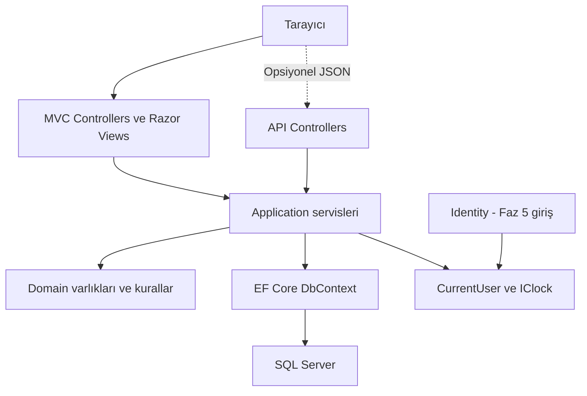

# Sistem mimarisi

Durum: tasarım; bu depoda çalışan uygulama veya yürütülmüş uygulama testleri yoktur.

## Yaklaşım
Katmanları adlandırılmış modüler monolit; tek deploy birimi. Mikroservis, CQRS/MediatR ve generic repository yok. EF Core DbContext zaten veri erişim sorumluluğunu üstlenir. Her sınıfa interface zorunlu değil; IClock ve ICurrentUser gibi dış bağımlılık sınırlarında interface faydalı.

## Faz 1
Tek StudyFlow.Web projesi: Controllers, Views, ViewModels, DemoData, wwwroot. DashboardController(Index,Weekly), CoursesController(Index,Details), ExamsController(Index,Details). Controller demo DTO’dan ViewModel üretir; kalıcı DB, Identity ve API yok. Ekran açıkça örnek veri etiketi taşır; Create butonları sahte başarı göstermemelidir.

## Faz 2 sonrası
Tek proje içinde Domain (varlık/enum), Application (CourseService, ExamService, TopicService, StudyTaskService, StudyPlanService, StudySessionService, DashboardService, StatisticsService), Infrastructure (DbContext, EF mappings, CurrentUser, Clock), Controllers/ViewModels/Views. Derleme projesi ayırmak ileride ölçülmüş ihtiyaç olursa ADR gerektirir. Domain MVC/EF Controller bağımlılığı taşımaz. Controller → servis → domain/veri erişimi. Servislerin bu küçük modelde Infrastructure DbContext’e erişmesi bilinçli pragmatik seçimdir; Clean Architecture saflığı iddia edilmez.

DI: DbContext/servisler scoped; IClock singleton güvenliyse; CurrentUser scoped. Sahiplik sunucu bağlamından; DemoCurrentUser yalnız Development. Kullanıcı tabloları Faz 2'de Identity ApplicationUser ile eşlenebilir; UI/kimlik doğrulama middleware'i Faz 5'te etkinleşir. Böylece null UserId veya sonradan sahipsiz veri migration'ı oluşmaz. Faz 2–4 demo hesap altyapısı kimlik yönetimi uygulanmış demek değildir.

## MVC ve API
MVC Controller GET ViewModel/HTML, POST form/anti-forgery/ModelState ve PRG üretir. API opsiyonel Faz 6 sonrası: Api/*Controller aynı servisleri çağırır, JSON DTO/ProblemDetails üretir; MVC kendi HTTP API'sini çağırmaz. API dosyası uygulanmadığında DTO alanları servis komutlarına eşlenir; HTTP metotları, kodlar, API yetkilendirme ve API testleri geliştirilmez. Form gösterimi, navigasyon ve responsive NFR’ler veri tablosu/API gerektirmez; istatistiklerde kalıcı özet tablosu gerekmemesi hesaplanan özellik istisnasıdır.

## İş mantığı ve hata
Durum geçişi, owner kontrolü ve zaman hesapları servis/domain sınırında; Razor sadece sunum. DomainValidation/NotFound/Conflict sonuçlarını MVC alan mesajına, API hata tipine adapter çevirir. Beklenmedik hata middleware’de traceId; logda yalnız teknik bağlam ve olay tipi. Kritik yazma transaction içinde; receipt/oturum eşzamanlılığı [DB tasarımı](08-database-design.md).

[Bileşen diyagramı](diagrams/component-architecture.mmd). Test kapsamı [test stratejisinde](14-testing-strategy.md).

[Dokümantasyon indeksi](../README.md)

## Diyagram

MVC ve opsiyonel API aynı servis katmanını çağırır; Identity giriş fazı sonrası CurrentUser sağlar. Faz1 yalnız MVC/DemoData kullanır.

