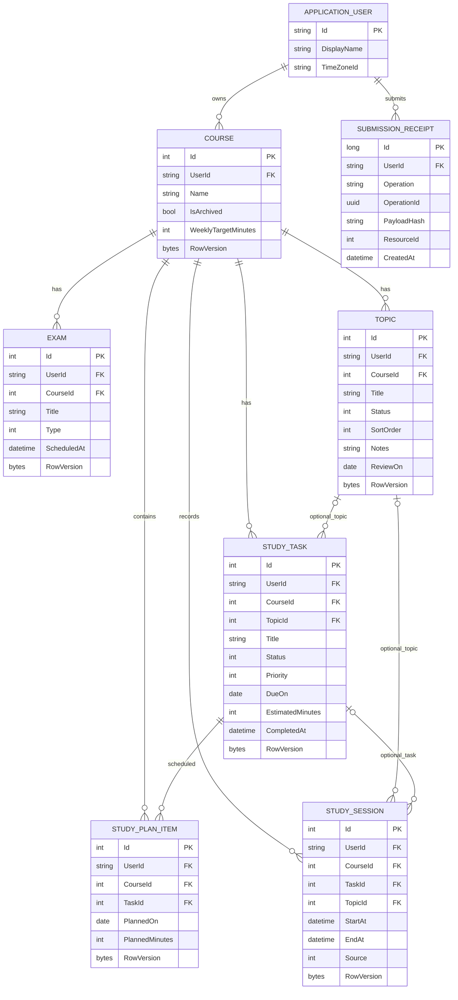

# Veritabanı tasarımı

Durum: tasarım; bu depoda çalışan uygulama veya yürütülmüş uygulama testleri yoktur.

## Hedef şema
Şema Faz 2–5 boyunca artımlı uygulanacaktır; bu depoda migration kodu yoktur. SQL Server hedeflenir. Domain nullable ile SQL NULL aynıdır. `ApplicationUser` tablosu Identity'nin AspNetUsers tablosudur; diğer tablolar çoğul isimle eşlenir. Identity'nin standart alan/tabloları framework tarafından oluşturulur.

## ApplicationUser

| Kolon | SQL Server tipi | NULL | Amaç |
| --- | --- | --- | --- |
| Id | nvarchar(450) | hayır | Identity kimliği ve sahiplik |
| Email | nvarchar(256) | evet | Identity standart alanı; kayıt akışında zorunlu ve normalize benzersiz |
| DisplayName | nvarchar(80) | hayır | Profil görünen adı |
| TimeZoneId | nvarchar(64) | hayır | Yerel gün hesabı; varsayılan Europe/Istanbul |

## Course

| Kolon | SQL Server tipi | NULL | Amaç |
| --- | --- | --- | --- |
| Id | int IDENTITY | hayır | PK |
| UserId | nvarchar(450) | hayır | Sahip FK |
| Name | nvarchar(120) | hayır | Ders adı |
| IsArchived | bit | hayır | Geçmişi koruyan etkinlik |
| WeeklyTargetMinutes | int | hayır | Ders haftalık hedefi, varsayılan 0 |
| CreatedAt | datetimeoffset(0) | hayır | UTC oluşturulma anı |
| RowVersion | rowversion | hayır | Optimistic concurrency; server üretir |

## Exam

| Kolon | SQL Server tipi | NULL | Amaç |
| --- | --- | --- | --- |
| Id | int IDENTITY | hayır | PK |
| UserId | nvarchar(450) | hayır | Owner kapsamı |
| CourseId | int | hayır | Ders FK |
| Title | nvarchar(120) | hayır | Sınav adı |
| Type | tinyint | hayır | Midterm=0, Final=1, Quiz=2, Other=3 |
| ScheduledAt | datetimeoffset(0) | hayır | Sınav anı; UTC normalize |
| CreatedAt | datetimeoffset(0) | hayır | UTC oluşturulma anı |
| RowVersion | rowversion | hayır | Optimistic concurrency; server üretir |

## Topic

| Kolon | SQL Server tipi | NULL | Amaç |
| --- | --- | --- | --- |
| Id | int IDENTITY | hayır | PK |
| UserId | nvarchar(450) | hayır | Owner kapsamı |
| CourseId | int | hayır | Ders FK |
| Title | nvarchar(160) | hayır | Konu adı |
| Status | tinyint | hayır | NotStarted=0, InProgress=1, Completed=2 |
| SortOrder | int | hayır | Kullanıcı sıralaması; eşitlik Id ile |
| Notes | nvarchar(2000) | evet | Kişisel konu notu |
| ReviewOn | date | evet | Tekrar takvim günü |
| CreatedAt | datetimeoffset(0) | hayır | UTC oluşturulma anı |
| RowVersion | rowversion | hayır | Optimistic concurrency; server üretir |

## StudyTask

| Kolon | SQL Server tipi | NULL | Amaç |
| --- | --- | --- | --- |
| Id | int IDENTITY | hayır | PK |
| UserId | nvarchar(450) | hayır | Owner kapsamı |
| CourseId | int | hayır | Ders FK |
| TopicId | int | evet | Aynı dersin opsiyonel konusu |
| Title | nvarchar(160) | hayır | Yapılacak iş |
| Status | tinyint | hayır | Pending=0, InProgress=1, Completed=2 |
| Priority | tinyint | hayır | Low=0, Normal=1, High=2 |
| DueOn | date | evet | Takvim son günü |
| EstimatedMinutes | int | hayır | Tahmin; gerçekleşmiş süre değil |
| CompletedAt | datetimeoffset(0) | evet | Son tamamlama anı; durum geri alınırsa null |
| CreatedAt | datetimeoffset(0) | hayır | UTC oluşturulma anı |
| RowVersion | rowversion | hayır | Optimistic concurrency; server üretir |

## StudyPlanItem

| Kolon | SQL Server tipi | NULL | Amaç |
| --- | --- | --- | --- |
| Id | int IDENTITY | hayır | PK |
| UserId | nvarchar(450) | hayır | Owner kapsamı |
| CourseId | int | hayır | Görevle eş ders; arşiv/sorgu/bileşik FK için kontrollü tekrar |
| TaskId | int | hayır | Planlanan görev |
| PlannedOn | date | hayır | Görevin planlandığı gün |
| PlannedMinutes | int | hayır | O gün ayrılan tahmini süre |
| CreatedAt | datetimeoffset(0) | hayır | UTC oluşturulma anı |
| RowVersion | rowversion | hayır | Optimistic concurrency; server üretir |

## StudySession

| Kolon | SQL Server tipi | NULL | Amaç |
| --- | --- | --- | --- |
| Id | int IDENTITY | hayır | PK |
| UserId | nvarchar(450) | hayır | Owner kapsamı |
| CourseId | int | hayır | Gerçekleşen çalışma dersi |
| TaskId | int | evet | Opsiyonel görev |
| TopicId | int | evet | Opsiyonel konu; görev konusu doluysa aynı olmak zorunda |
| StartAt | datetimeoffset(0) | hayır | UTC başlangıç; zamanlayıcıda sunucu üretir |
| EndAt | datetimeoffset(0) | evet | UTC bitiş; null açık oturum |
| Source | tinyint | hayır | Timer=0, Manual=1 |
| CreatedAt | datetimeoffset(0) | hayır | UTC oluşturulma anı |
| RowVersion | rowversion | hayır | Optimistic concurrency; server üretir |

## SubmissionReceipt

| Kolon | SQL Server tipi | NULL | Amaç |
| --- | --- | --- | --- |
| Id | bigint IDENTITY | hayır | Teknik PK |
| UserId | nvarchar(450) | hayır | İşlemi yapan sahip |
| Operation | nvarchar(64) | hayır | Örn Course.Create |
| OperationId | uniqueidentifier | hayır | Form nonce veya API key UUID |
| PayloadHash | char(64) | hayır | Normalize DTO SHA256; gizli bilgi içermez |
| ResourceId | int | hayır | Oluşturulan iş kaydının kimliği; generic FK değil |
| CreatedAt | datetimeoffset(0) | hayır | UTC receipt zamanı |

## Anahtarlar, FK ve silme
Her tabloda PK Id. Course alternatif anahtar (UserId,Id). Topic ve StudyTask alternatif anahtar (UserId,CourseId,Id). Exam/Topic/Task/Session/Plan (UserId,CourseId) → Course(UserId,Id); Task ve Session (UserId,CourseId,TopicId) → Topic(UserId,CourseId,Id); Plan ve Session (UserId,CourseId,TaskId) → StudyTask(UserId,CourseId,Id). Nullable FK’de TopicId/TaskId null olabilir; diğer kolonlar nullable yapılmaz. Her UserId → AspNetUsers.Id. Tüm ilişkiler DeleteBehavior.NoAction; SQL Server çoklu cascade yolundan kaçınılır.

Silme matrisi: ilişkisiz Course delete; bağlı Course 409+arşiv; bağlı Topic 409; bağlı StudyTask 409; StudyPlanItem delete oturumu etkilemez; Exam ve bitmiş/açık Session aktif derste delete olabilir. Arşivli dersin alt kaydını silmek için önce geri aç. İş kaydı ve receipt FK bağımsızdır; receipt geçmişi silinmiş kayda yeniden işlem üretmez.

## Unique / check / index
- AspNetUsers.NormalizedEmail benzersiz filtreli indeks; kayıt e-posta zorunlu; Identity standart NormalizedUserName benzersizliği korunur.
- Plan unique (UserId,TaskId,PlannedOn). Aynı görev bir gün yalnız bir kez; farklı günler serbest.
- Session unique filtered (UserId) WHERE EndAt IS NULL: kullanıcı başına tek açık oturum.
- Receipt unique (UserId,Operation,OperationId).
- Course hedef 0..10080; trim ad 1..120. Topic SortOrder >=0; enum değerleri ilgili aralıkta. Task EstimatedMinutes 1..1440, Status/Priority 0..2, (Status=2 AND CompletedAt IS NOT NULL) OR (Status<>2 AND CompletedAt IS NULL). Plan süre 1..1440.
- Session EndAt null ise Source=Timer; doluysa EndAt>StartAt ve DATEDIFF_BIG(second,StartAt,EndAt)<=86400; Source 0..1. Gelecek zaman check constraint’i nondeterministic now ile yapılmaz, servis IClock ile doğrular.
- Öneri indeksleri: Course(UserId,IsArchived,Name); Exam(UserId,ScheduledAt); Task(UserId,Status,DueOn); Topic(UserId,CourseId,SortOrder); Plan(UserId,PlannedOn); Session(UserId,StartAt) INCLUDE EndAt,CourseId,TaskId. Gerçek execution plan ile doğrula; gereksiz indeks ekleme.

## EF eşleme ve transaction
Fluent API: HasMaxLength/IsRequired, DateOnly→date sağlayıcı uyumluluğu doğrulanır; IsRowVersion; HasAlternateKey; HasForeignKey bileşik kolon sırası birebir aynı; HasIndex(...).IsUnique().HasFilter("[EndAt] IS NULL"). Enumlar tinyint conversion. Check adları CK_* olarak migration’a yazılır. UserId global query filter yardımcı olabilir; servis CurrentUser kapsamı zorunludur; filter atlamaya güvenlik testi gerekir.

Oturum oluştur/bitir/düzelt/sil ve ders arşivle servisleri transaction başında AspNetUsers satırını UPDLOCK,HOLDLOCK ile kilitler; tüm bu işlemler aynı kilit sırasını kullanır. Sonra owner/ders/açık oturum/çakışma kontrolü ve insert/update yapılır. Bu küçük üründe kullanıcı başına serialization farklı oturum aralıklarının eşzamanlı çakışmasını ve arşiv yarışını engeller. Rowversion düzenleme yarışını, filtered unique açık oturum yarışını ayrıca korur. Aralık çakışması mevcut.StartAt < yeni.EndAt ve (mevcut.EndAt null veya mevcut.EndAt > yeni.StartAt); kendi kaydı hariç. Bitişik aralıklar kabul edilir. Start Timer geçmiş kayıtla çakışmayı, Stop bitişe kadar aralığı tekrar kontrol eder.

Tekrarlanan POST transaction içinde receipt oluşturur; unique yarışında rollback yapıp mevcut receipt/hash kontrol edilir. Receipt yalnız domain kaynak oluşturma içindir, Identity parola/login body’si için değildir. Course/topic arşiv yarışına karşı tüm ders alt kayıt yazmaları da aynı owner satır kilidini alır.

## Migration ve örnek veri
Faz 2: Identity sahip tablosu+Course+Exam+Receipt; Faz 3 Topic/Task/Plan; Faz 4 Session; Faz 5 gerçek auth konfigürasyonu. Migration review → boş SQL Server → önceki şema yükseltme → test → yedek/geri dönüş planı. Production otomatik startup migrate yok; script kontrollü uygulanır. Destructive migration önce veri kaybı analizi. Demo seed yalnız Development, sabit tarih yerine IClock’tan göreli örnek tarih; Id yeniden seed’de duplicate üretmez.

Örnek: A kullanıcısı Course 1 Algoritmalar hedef120; Topic 1 Diziler; Task 1 20 soru tahmin60; Plan Task1 2026-11-09 süre60; Session 2026-11-09 09:00–09:45 +03:00. Beklenen gerçek45/fark -15; bu değerler hesaplanır, saklanmaz. B kullanıcısı Course2; A’nın Topic/Task kaydı Course2’ye bağlanamaz.

[ER kaynağı](diagrams/entity-relationship.mmd). Diyagramdaki ilişkiler 1:N'dir; bileşik owner FK ayrıntısında bu doküman normatiftir.

[Dokümantasyon indeksi](../README.md)

## Diyagram

Opsiyonel TopicId/TaskId ilişkileri sıfır veya bir ebeveyni gösterir. UserId alt tablolarda vardır; owner FK ve NULL/silme detayları şema tablolarında normatiftir. Mermaid datetime anları SQL datetimeoffset, bytes rowversion temsil eder. Ortak CreatedAt alanları görsel sadelik için çizimde gösterilmedi; şemada mevcuttur.

