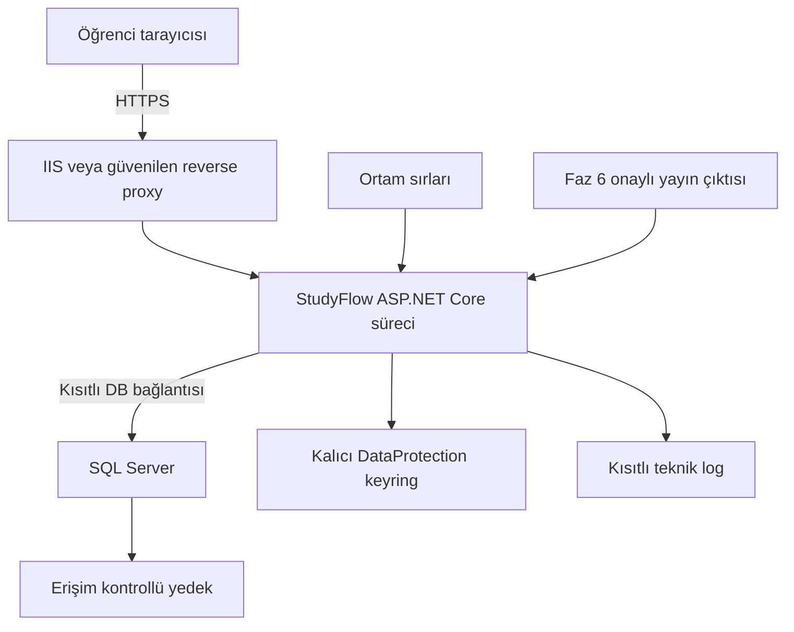

# Dağıtım ve yapılandırma

Durum: tasarım; bu depoda çalışan uygulama veya yürütülmüş uygulama testleri yoktur.

## Geliştirme başlangıcı
Bu depoda uygulama kaynak kodu/csproj yok; aşağıdaki komutlar gelecekte oluşturulacak proje içindir. Önce öğretim görevlisinin lab SDK’sını, Microsoft resmi destek politikasını, EF Core/SQL Server provider/Identity/xUnit ve ASP.NET test paketi uyumunu doğrula; güncel desteklenen sürümü ADR’ye yaz. Bu belge varsayımla sürüm numarası sabitlemez. Gerekli: uyumlu .NET SDK, C# IDE, Git, tarayıcı; Faz2 SQL Server instance + yönetim aracı. Sürümler seçilince global.json ve paket sürümleri tutarlı sabitlenir; lab makinesiyle build kontrol edilir.

Örnek komutların `<verified-sdk-version>`/`<project>` değerleri ADR sonrası değiştirilir, olduğu gibi çalıştırılmaz:

```bash
dotnet --info
dotnet new mvc -n StudyFlow.Web
# Oluşan hedef framework seçilmiş desteklenen sürümle karşılaştırılır.
dotnet restore <project>
dotnet build <project>
dotnet run --project <project>
```

Faz2 dotnet-ef uyumlu sürümü kurulduktan sonra:

```bash
dotnet ef migrations add InitialCourseExam --project <project>
dotnet ef database update --project <project>
dotnet test <solution>
```

## Yapılandırma
appsettings.json: gizli olmayan Logging, feature flags; appsettings.Development.json örnek yapılandırma, gerçek secret yok. launchSettings geliştirme portları (kesin port template sonrası); Production farklı. Yerel connection string user-secrets, Production secret store/env:

| Anahtar | Anlam | Faz |
| --- | --- | --- |
| ConnectionStrings__StudyFlow | SQL Server bağlantısı; gerçek değer repoya yazılmaz | 2 |
| ASPNETCORE_ENVIRONMENT | Development/Production; demo guard | 1+ |
| StudyFlow__DemoMode | true yalnız Development; Production true fail-fast | 2–4 |
| StudyFlow__DefaultTimeZoneId | Europe/Istanbul başlangıç varsayımı; profille değişir | 2+ |
| Logging__LogLevel__Default | Yerel Debug, Production uygun Information/Warning | 1+ |

## Production ve dağıtım
Sağlayıcı kesinleşmedi. Seçenekler: IIS/Windows hosting veya ASP.NET Core çalıştıran Linux host + reverse proxy + ayrı SQL Server; öğrenci erişimi/maliyet/SQL desteği karşılaştırılarak Faz6 seçilir. Faz1 DB'siz yerel demo; Faz2–4 public host yok. `dotnet publish -c Release` yalnız kaynak ve hedef oluşturulduğunda; çıktıda secret aranır. Production detailed errors kapalı; HTTPS/HSTS, forwarded headers yalnız güvenilen proxy, DataProtection keyring kalıcı. Kestrel reverse proxy ayarları seçilen host resmi dokümanında doğrulanmalıdır.

[Dağıtım diyagramı](diagrams/deployment.mmd) sağlayıcıdan bağımsız hedef düzeni gösterir. MVC/API aynı süreç; API opsiyonel. SQL public internet portuna açık bırakılmaz; host→DB kısıtlı ağ ve minimum izinler.

## Migration, rollback ve yedek
Üretim öncesi gerçek SQL backup al → staging restore → migration script üret/review → transaction destek sınırını kontrol et → kontrollü uygula → smoke ve count/integrity kontrol. Startup otomatik migrate yok. Başarısız schema değişiminde app sürüm rollback tek başına yeterli olmayabilir; geriye uyumlu şema veya backup restore planı. Hedef: günlük backup, en fazla24saat veri kaybı, restore<=2saat; ölçülmemiş hedef ve host kararı sonrası revize. Restore deneyi yapılmadan backup var demek yeterli değil. Geliştirme seed production çalışmaz; test DB cleanup gerçek DB'ye bağlanamaz.

Log traceId+olay tipi; DB timeout ve exception teknik bilgi içerir ancak request body/connection string yok. Debugging breakpoint yerelde, Production debug sayfası yok. Dağıtım sağlayıcısının sorumlu kişisi Faz6 ekip planında; üç kişi runbook’u okuyabilir.

[Dokümantasyon indeksi](../README.md)

## Diyagram

Sağlayıcı kesinleşmemiştir; IIS veya reverse proxy seçimi alternatiflerdir. HTTPS uygulamaya, uygulama kısıtlı SQL bağlantısına ulaşır. Sırlar ve yedek çalışma verisinden ayrı yönetilir.


